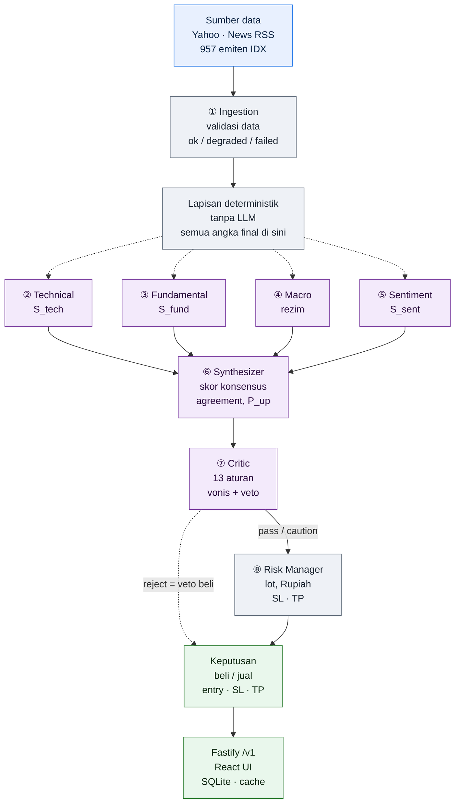
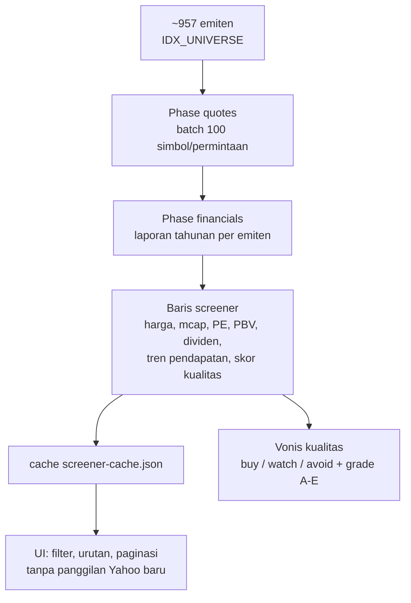
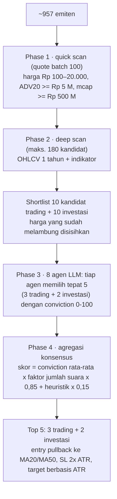

<<<<<<< HEAD
# Agentic Market Desk

Sistem multi-agen berbasis LLM + kuantitatif deterministik untuk analisis dan prediksi saham Bursa Efek Indonesia (BEI/IDX). Backend Fastify, frontend React/Vite, seluruh nilai mata uang dalam Rupiah.

[](https://nodejs.org)
[](https://www.typescriptlang.org)
[](https://fastify.dev)
[](https://react.dev)
[](https://nodejs.org/api/sqlite.html)
[](#19-lisensi)

Repositori: <https://github.com/faridev33/ai-agents-saham> (branch `main`). Tidak ada instance publik — jalankan lokal, lihat [§5](#5-instalasi-konfigurasi--menjalankan).

Dokumen ini adalah satu-satunya acuan proyek: ringkasan, arsitektur, parameter agen, aturan audit, manajemen risiko, pipeline, API, dan status implementasi.

## Demo


Halaman **Kantor** (`frontend/src/components/OfficePage.tsx`): kantor virtual Three.js dengan satu stasiun per agen, status live tiap stasiun, panel "Tim analis" di kanan, dan quote emiten di header. Tab lain: Screener, Berita, Cek Saham, Analisa, Jalankan.

---

## Arsitektur Sistem

Inti desainnya satu kalimat: **semua angka dihitung kode, semua penilaian dilakukan agen.** Tidak ada skor, harga, atau ukuran posisi yang berasal dari model bahasa — LLM hanya membaca angka itu, menilai maknanya, dan memberi keberatan.



| Warna | Lapisan | Isi | Siapa yang menghitung |
|---|---|---|---|
| biru | Sumber data | quote, OHLCV 3 tahun, fundamental, berita 45 hari, 7 seri makro | Yahoo Finance + Google News RSS (`providers/`), universe internal |
| abu | Deterministik | SMA/RSI/MACD/ATR, PER/PBV/ROE/DER, rezim makro, ¼ Kelly, 2×ATR, 6 kendala alokasi | kode TypeScript (`lib/`, `agents/*`), tanpa LLM |
| ungu | Agen LLM | konteks, konflik antar sinyal, keberatan, vonis | model bahasa; tanpa `LLM_API_KEY` jatuh ke heuristik deterministik |
| hijau | Keluaran | keputusan, rencana trade, lot, Rupiah, jejak audit | penyusunan deterministik, dengan hak veto Critic |

Garis putus-putus = angka dari lapisan deterministik dikirim ke agen sebagai fakta, bukan untuk dihitung ulang. Empat analis (②–⑤) menerima konteks yang sama dan berjalan paralel — tidak ada yang menunggu hasil yang lain — sebelum Synthesizer menggabungkan keempat sudut pandang itu. Urutan nomor ①–⑧ sama dengan urutan eksekusi satu analisis (`services/analysisService.ts`) dan sama dengan urutan di tabel [§7](#7-delapan-agen).

Alur per pipeline (screener, Top Picks, analisis satu emiten) ada di [§10](#10-pipeline-end-to-end). Versi poster rinci untuk lampiran/naskah: [`ARSITEKTUR_AGENTIC_DIAGRAM.svg`](ARSITEKTUR_AGENTIC_DIAGRAM.svg) (sumber [`ARSITEKTUR_AGENTIC_DIAGRAM.mmd`](ARSITEKTUR_AGENTIC_DIAGRAM.mmd)).

---

## Ringkasan Cepat

| Aspek | Nilai |
|---|---|
| Cakupan | ~957 emiten BEI (`backend/src/data/idxUniverse.ts`) |
| Agen | 8 agen (4 analis paralel + synthesizer + risk guardian + critic 13 aturan) |
| Backend | Node.js >= 22.5 · TypeScript · Fastify 5 · Zod 4 · SQLite |
| Frontend | React 19 · Vite 8 · Three.js / React Three Fiber 9 |
| Port | backend `3000`, frontend dev `5173` |
| Sumber data | Yahoo Finance · Google News RSS Indonesia · universe BEI internal |
| Output | keputusan `strong_buy`…`sell`, rencana entry/SL/TP, ukuran lot, alokasi Rupiah |

## Daftar Isi

- [Demo](#demo)
- [Arsitektur Sistem](#arsitektur-sistem)

1. [Ringkasan & Filosofi](#1-ringkasan--filosofi)
2. [Fitur](#2-fitur)
3. [Struktur Folder](#3-struktur-folder)
4. [Stack & Versi](#4-stack--versi)
5. [Instalasi, Konfigurasi & Menjalankan](#5-instalasi-konfigurasi--menjalankan)
6. [Sumber Data (3 Pilar)](#6-sumber-data-3-pilar)
7. [Delapan Agen](#7-delapan-agen)
8. [Protokol Audit 13 Aturan](#8-protokol-audit-13-aturan-contrarian-critic)
9. [Manajemen Risiko: 6 Kendala](#9-manajemen-risiko-6-kendala)
10. [Pipeline End-to-End](#10-pipeline-end-to-end)
11. [API](#11-api)
12. [Penyimpanan & Cache](#12-penyimpanan--cache)
13. [Backtest & Bukti Evaluasi](#13-backtest--bukti-evaluasi)
14. [Testing & Typecheck](#14-testing--typecheck)
15. [Status Implementasi](#15-status-implementasi)
16. [Keterbatasan](#16-keterbatasan)
17. [Catatan Repo](#17-catatan-repo)
18. [Kontribusi](#18-kontribusi)
19. [Lisensi](#19-lisensi)

---

## 1. Ringkasan & Filosofi

Bayangkan sebuah kantor investasi yang mempekerjakan 8 pakar AI yang bekerja 24 jam menyaring saham BEI — itu bentuk sistem ini. Alasannya sederhana: pendekatan tunggal selalu gagal di pasar modal.

1. **ML/statistik murni** terjebak hipotesis pasar efisien semi-kuat — indikator teknikal historis hanya menghasilkan akurasi arah 49%–53% pada emiten likuid LQ45.
2. **LLM tunggal** rentan halusinasi numerik saat membaca laporan keuangan, *reasoning-action misalignment* (argumen hati-hati tapi aksi agresif), dan tidak punya kendala kuantitatif.

Solusinya **Neuro-Symbolic Architecture**:

- **Lapisan simbolik deterministik** — SMA, RSI, MACD, ATR, Z-score, ROE, PER, Kelly criterion, pembatas eksposur. Angka tidak pernah dikarang LLM.
- **Lapisan kognitif LLM** — membaca semantik berita keuangan berbahasa Indonesia dan bertindak sebagai *adversarial red-team* yang menantang konsensus.
- **Konsensus + supervisi transisi** — order hanya terbit bila keyakinan gabungan melewati ambang dan lolos 13 filter audit deterministik.

Diagram sumber tersedia dalam `ARSITEKTUR_AGENTIC_DIAGRAM.mmd` (Mermaid) dan hasil render `ARSITEKTUR_AGENTIC_DIAGRAM.svg`.

---

## 2. Fitur

- **Kantor** — ruang kerja virtual 3D yang menampilkan status 8 agen secara real-time, dilengkapi **Pemantauan Portofolio** (KPI ekuitas, P/L, alokasi sektor, tabel posisi) di bawah Ruang Analisa.
- **Screener** — memindai seluruh universe BEI (~957 emiten) dengan filter pencarian, sektor, rentang harga, anti-gorengan, batas DER, pertumbuhan pendapatan, dan vonis kualitas; hasil di-cache agar pencarian/urutan/paginasi tidak menembak Yahoo lagi.
- **Berita** — agregasi kabar pasar IDX dan emiten besar, filter topik, pencarian simbol.
- **Cek Saham** — pengecekan cepat tanpa LLM: grafik interaktif, ringkasan 52 minggu, rasio valuasi & profitabilitas, kinerja keuangan tahunan, profil bisnis. Rasio dibaca dari cache screener; bila belum ada, UI meminta pemindaian dulu alih-alih mengarang angka.
- **Analisa** — 5 Emiten Rekomendasi Beli hasil musyawarah 8 agen atas hasil pemindaian ~957 emiten IDX, lengkap dengan skor konsensus, suara agen (termasuk model yang dipakai), rencana entry/SL/TP, indikator, dan alur metodologi.
- **Jalankan** — menjalankan pipeline 8 agen terhadap emiten pilihan sendiri, dengan pengaturan modal, horizon (Trading/Investasi/Keduanya), manajemen risiko ATR/Kelly, dan panel makro.
- **Status AI** — chip & modal kesehatan LLM di header (`/v1/health/llm`) yang membedakan `healthy` / `error` / `disabled` (tanpa `LLM_API_KEY`) / `unknown`.
- **Tema terang/gelap** — preferensi disimpan di browser, diterapkan sebelum render.
- **Rupiah** — harga, kapitalisasi, nilai posisi, batas risiko selalu format IDR.

Navigasi header: **Kantor · Screener · Berita · Cek Saham · Analisa · Jalankan**.

---

## 3. Struktur Folder

```text
Agent/
├── backend/                    # API Fastify, agen analisis, SQLite
│   ├── src/
│   │   ├── agents/             # technical, fundamental, macro, sentiment,
│   │   │                       #   riskManager, critic, synthesizer, sentimentLexicon
│   │   ├── api/                # analysis, market, macro, screener, topPicks,
│   │   │                       #   backtest, portfolio, llmHealth, schemas
│   │   ├── backtest/           # engine.ts, metrics.ts, walkForward.ts
│   │   ├── data/               # idxUniverse.ts (~957 emiten), idxCompanies.ts (profil)
│   │   ├── lib/                # indicators, math, errors, logger
│   │   ├── llm/                # client.ts (OpenAI-compatible + Zod schema)
│   │   ├── providers/          # yahoo.ts, cache.ts (TtlCache), types.ts
│   │   ├── services/           # analysis, screener, topPicks, quality,
│   │   │                       #   llmHealth, backtest
│   │   ├── storage/            # decisions.ts, portfolio.ts (SQLite), types.ts
│   │   ├── app.ts              # perakitan Fastify: rute, CORS, error handler, static web
│   │   ├── config.ts           # skema env (Zod) + batas risiko
│   │   └── index.ts            # entrypoint server
│   ├── tests/                  # 6 berkas test + helpers.ts (tsx --test)
│   ├── tmp_eval/               # bukti evaluasi: eval.mjs, results.json, summary.json
│   ├── data/                   # app.db, screener-cache.json, top-picks.json (runtime)
│   ├── data-test/              # app.db khusus test
│   └── .env.example
├── frontend/                   # UI React + Vite
│   ├── src/
│   │   ├── components/         # Kantor, Screener, Berita, Cek Saham, Analisa,
│   │   │                       #   Jalankan, PortfolioTracker, StockChart, panel, dll
│   │   ├── office3d/           # Office3D, environment, props, layout, textures, look
│   │   ├── api.ts              # klien HTTP + tipe respons
│   │   ├── theme.ts, format.ts, market.ts, useTopPicks.ts, useLlmHealth.ts
│   │   └── styles.css
│   ├── vite.config.ts          # port 5173 + proxy /v1 dan /health ke :3000
│   └── index.html
├── jurnal_assets/              # figure + script naskah
│   ├── figs.py, stats.py       # fig1_arsitektur/fig2_hasil/fig3_risiko.png
│   ├── build_journal_md.py     # menghasilkan jurnal.md
│   └── extract_meta.py, meta.json, meta_dump.txt, check_load.py
├── ARSITEKTUR_AGENTIC_DIAGRAM.mmd / .svg
└── package.json                # skrip orkestrasi root
```

`dist/`, `node_modules/`, `data/`, `.env`, `*.log` seharusnya dapat dibangun/dibuat ulang — lihat [Catatan Repo](#17-catatan-repo) karena `.gitignore` saat ini belum menutupinya.

---

## 4. Stack & Versi

Versi diambil langsung dari `package.json` masing-masing paket.

**Backend** (`agentic-market-backend`, `type: module`, engine `node >= 22.5`)

| Paket | Versi | Peran |
|---|---|---|
| fastify | ^5.12.7 | HTTP server |
| @fastify/static | ^10.1.8 | melayani `frontend/dist` bila ada |
| yahoo-finance2 | ^4.0.5 | quote, OHLCV, fundamental, profil, makro |
| zod | ^4.6.7 | validasi env, body, & skema JSON balasan LLM |
| dotenv | ^17.2.3 | pemuatan `.env` |
| tsx ^4.20.6 · typescript ^5.9.3 | dev | dev server (`tsx watch`), build (`tsc`), test (`tsx --test`) |

**Frontend** (`agentic-market-web`)

| Paket | Versi | Peran |
|---|---|---|
| react / react-dom | ^19.3.1 | UI |
| three | ^0.186.1 | mesin 3D kantor |
| @react-three/fiber | ^9.8.2 | renderer React untuk Three.js |
| @react-three/drei | ^10.7.9 | helper scene 3D |
| vite ^8.3.5 · typescript ^7.0.2 | dev | bundler + typecheck |

**Penyimpanan**: `node:sqlite` (bawaan Node >= 22.5) — tanpa dependensi eksternal.

---

## 5. Instalasi, Konfigurasi & Menjalankan

Prasyarat: **Node.js >= 22.5** (butuh modul `node:sqlite`).

```bash
npm run install:all
cp backend/.env.example backend/.env    # Windows: Copy-Item backend\.env.example backend\.env
```

Isi `LLM_API_KEY` bila ingin sentimen dan critic berbasis LLM. Tanpa API key aplikasi tetap jalan memakai leksikon dan heuristik deterministik (status AI di header akan menampilkan `disabled`).

Development (dua terminal):

```bash
npm run dev            # backend, port 3000
npm run dev:frontend   # frontend, http://localhost:5173
```

Vite mem-proxy `/v1` dan `/health` ke `http://127.0.0.1:3000`.

Build & produksi:

```bash
npm run build && npm start   # backend melayani API + hasil build frontend di :3000
```

### Skrip root

| Perintah | Aksi |
|---|---|
| `npm run install:all` | `npm install` di `backend` dan `frontend` |
| `npm run dev` / `dev:backend` | backend `tsx watch` |
| `npm run dev:frontend` | Vite dev server (5173) |
| `npm run build` | build backend (`tsc`) lalu frontend (`tsc --noEmit && vite build`) |
| `npm run build:backend` / `build:frontend` | build salah satu paket saja |
| `npm start` | jalankan backend dari `dist/` |
| `npm test` | test backend (`tsx --test tests/*.test.ts`) |
| `npm run typecheck` | typecheck backend + frontend |

### Variabel lingkungan

Dibaca dan divalidasi di `backend/src/config.ts`; nilai di bawah adalah default bila `.env` kosong.

| Variabel | Default | Keterangan |
|---|---|---|
| `PORT` | `3000` | port HTTP server |
| `HOST` | `0.0.0.0` | alamat bind |
| `LOG_LEVEL` | `info` | `fatal`…`trace`/`silent`; header `authorization` & `cookie` diredaksi |
| `DATA_DIR` | `./data` | folder SQLite & cache JSON |
| `WEB_DIR` | `../frontend/dist` | hasil build frontend, relatif terhadap folder `backend` |
| `CORS_ORIGIN` | `*` | daftar origin dipisah koma, atau `*` |
| `LLM_API_KEY` | _(kosong)_ | kunci gateway LLM; kosong = mode heuristik |
| `LLM_BASE_URL` | `https://api.openai.com/v1` | endpoint OpenAI-compatible |
| `LLM_MODEL` | `gpt-4o-mini` | model utama |
| `LLM_MODELS` | sama dengan `LLM_MODEL` | roster model dipisah koma; dipakai 8 agen Analisa agar tetap jalan saat satu model down (urutan = prioritas) |
| `LLM_TIMEOUT_MS` | `20000` | batas waktu satu permintaan LLM (1.000–120.000) |
| `BENCHMARK_SYMBOL` | `^GSPC` | benchmark default untuk backtest & makro |
| `MAX_RISK_PER_TRADE_PCT` | `1` | risiko maksimal per transaksi (% ekuitas) |
| `TARGET_VOLATILITY_PCT` | `15` | target volatilitas portofolio |
| `MAX_POSITION_PCT` | `20` | plafon satu posisi |
| `MAX_DRAWDOWN_PCT` | `15` | ambang kill switch |
| `MAX_SECTOR_EXPOSURE_PCT` | `35` | plafon eksposur per sektor |

Semua batas risiko di-clamp ke rentang wajar saat validasi, jadi nilai ekstrem di `.env` tidak akan melewati sistem.

---

## 6. Sumber Data (3 Pilar)

**A. Yahoo Finance (`yahoo-finance2`)** — TTL aktual dari `providers/yahoo.ts`:

| Data | Isi | TTL cache |
|---|---|---|
| Quote | `regularMarketPrice`, `previousClose`, `changePercent`, `volume`, `averageDailyVolume10Day`, `marketCap`, 52-week high/low | 30 detik |
| OHLCV harian | `open/high/low/close/volume/adjClose/date`, horizon 1 bulan–3 tahun | 5 menit |
| Fundamental (`quoteSummary`) | modul `price`, `summaryDetail`, `defaultKeyStatistics`, `financialData`, `summaryProfile`, `calendarEvents` → PE, PBV, EV/EBITDA, PEG, FCF, ROE, ROA, margin, DER, current ratio, growth, earnings date | 6 jam |
| Laporan tahunan (`fundamentalsTimeSeries`) | neraca, laba rugi, arus kas 2018+; modul finansial diperlakukan berbeda dari non-keuangan (sektor *financial* tidak diukur dengan DER/current ratio) | 6 jam |
| Profil (`assetProfile`) | deskripsi bisnis, alamat, sektor, industri, karyawan, direksi | 6 jam |
| Makro | `^JKSE` IHSG, `^VIX`, `^TNX` (US10Y), `^IRX` (US3M), `DX-Y.NYB` (DXY), `GC=F` emas, `CL=F` WTI | 10 menit |

**B. Google News RSS Indonesia** — `https://news.google.com/rss/search?q={query}&hl=id&gl=ID&ceid=ID:id`, query `saham {KODE} OR "{KODE}.JK"` dan `saham IHSG OR bursa efek indonesia`. Mengambil headline, penerbit (CNBC/Kontan/Bisnis/Detik/Investor Daily), tanggal, tautan. TTL 5 menit.

**C. Universe internal** — `backend/src/data/idxUniverse.ts` (957 entri) + `idxCompanies.ts`: ticker, nama PT, sektor IDX-IC, sub-sektor, industri, papan pencatatan, tanggal IPO. Frontend punya daftar ringkas 36 emiten likuid di `frontend/src/market.ts` untuk saran simbol dan keranjang berita.

---

## 7. Delapan Agen

| # | Agen | Tugas | Output |
|:--:|---|---|---|
| 1 | **Data Ingestion** | Menarik data 3 pilar, memvalidasi kelengkapan, membersihkan anomali, menjaga kesegaran timestamp | status `ok`/`degraded`/`failed`, jumlah candle valid, bendera fundamental & makro |
| 2 | **Technical Trend** | Tren, momentum, osilator, konfirmasi breakout via volume | `S_tech ∈ [-1,+1]`, `C_tech ∈ [0.1,0.9]`, label arah tren |
| 3 | **Fundamental Value** | Audit valuasi, profitabilitas, solvabilitas, pertumbuhan | `S_fund ∈ [-1,+1]`, `C_fund ∈ [0.1,0.85]`, kelas Murah/Wajar/Mahal |
| 4 | **Macro Regime** | Iklim makro domestik & global | rezim `risk_on`/`neutral`/`risk_off`, tren suku bunga, tekanan Rupiah |
| 5 | **News & Sentiment** | Agregasi ≤12 artikel dalam 45 hari, leksikon Indonesia, deteksi event, recency decay | `S_sent ∈ [-1,+1]`, daftar event, cakupan berita 14 hari |
| 6 | **Synthesizer** | Bobot dasar per horizon disesuaikan rezim makro, agregasi skor + agreement, estimasi `P_up` | skor konsensus `[-1,+1]`, `P_up`, daftar konflik rezim |
| 7 | **Critic** | Red-team independen: 13 aturan audit, deteksi konflik, hak veto | vonis `pass`/`caution`/`reject`, confidence multiplier, objections |
| 8 | **Risk Manager** | Ukuran posisi dari 6 kendala, SL `2×ATR`, TP `2R`, cek kill switch | keputusan `strong_buy`...`sell`, rencana entry/SL/TP, lot, alokasi Rupiah |

Nomor = urutan eksekusi satu analisis; kedelapan entri ini yang terdaftar sebagai `OFFICE_ROSTER` di `services/analysisService.ts` dan tampil di kantor 3D. Aritmetika volatilitas, proksi Sharpe, ADV, dan drawdown bukan agen terpisah — tinggal di `lib/math.ts` lalu dipakai Technical, Risk Manager, dan pipeline Top Picks.

### Parameter per agen

**Technical** (semua diskalakan `tanh` agar tahan outlier; komposit = `0.42·trend + 0.32·momentum + 0.11·volume + 0.15·volatilitas`):

- Sub-skor tren *(bobot total 100% dalam blok tren)*: SMA20 **20%** `tanh((Close/SMA20 − 1)/0.04)`; SMA50 **30%** `tanh((Close/SMA50 − 1)/0.06)`; golden/death cross **25%** `tanh((SMA50/SMA200 − 1)/0.05)`; slope SMA50 10-bar **25%** `tanh((SMA50/SMA50,t−10 − 1)/0.03)`
- Sub-skor momentum: RSI-14 **35%** `tanh((RSI−50)/18)`; MACD(12,26,9) dinormalisasi ATR **35%** `tanh(Hist_MACD/(0.6·ATR14))`; ROC-20 **30%** `tanh(ROC20/10)`
- Blok volume: OBV 20-bar **70%** + konfirmasi Z-score volume **30%** `Z = (Vol_t − μ20)/σ20`, diskalakan `tanh(Z/2)`
- Volatilitas terannualisasi 60 hari: `σ_ann = σ(log return)·√252`, penalti `−tanh((σ_ann − 35%)/25%)`
- Label volatilitas: `>50%` tinggi, `>30%` sedang, sisanya rendah; peringatan bila `σ_ann > 80%`
- Posisi harga dalam rentang 52 minggu (`from52wHighPct`, `range52PositionPct`)

**Fundamental**: valuasi 35% (ramp trailing/forward PER optimal ≤12 memburuk ke 40; PBV 1.5x→10x; EV/EBITDA optimal 6–8x; FCF yield 0%→8%) · kualitas 42% (ROE 1.0 bila ≥25%, memburuk <8%; operating & net margin; DER prima ≤30%, penalti >250%; current ratio optimal 1.5–2.2x) · pertumbuhan 23% (revenue −10%→+25%, laba −20%→+30%). **Khusus sektor finansial/bank** (mis. BBCA/BBRI/BMRI): DER & current ratio diabaikan/disesuaikan karena neraca didominasi DPK.

**Macro** (dari `agents/macro.ts`): VIX `<12 → +0.8`, `<16 → +0.5`, `<20 → netral`, `<25 → −0.2`, `<30 → −0.5`, `<40 → −0.8`; perubahan VIX 20 hari `>+25%` memberi penalti `−0.15`, `<−25%` bonus `+0.10` · spread US10Y−US3M `>+1.5%` sehat (+0.6), inversi → sinyal resesi (−0.8) · DXY 20 hari: `tanh(−ΔDXY/2.5)` (dolar menguat = capital flight) · IHSG: posisi vs SMA200 (bobot 50%, ±0.8), vs SMA50 (bobot 20%), Δ60 hari `tanh(ΔIHSG/10)`. Semua komponen digabung *weighted mean* lalu keyakinan `= clamp(0.15, 0.8, 0.15 + 0.6·komponen tersedia/jumlah komponen)`.

**Synthesizer**: bobot dasar per horizon — *trading* `{technical 0.55, sentiment 0.20, macro 0.20, fundamental 0.05}`, *investasi* `{fundamental 0.55, macro 0.25, technical 0.12, sentiment 0.08}`. Penyesuaian rezim: `risk_off` → macro ×1.35, technical ×0.85; `risk_on` → technical ×1.1, sentiment ×1.1, macro ×0.9. Bobot tiap agen efektif dikalikan `(0.35 + 0.65·confidence)`. Ambang aksi: skor `≥0.50` `strong_buy`, `≥0.18` `buy`, `≤−0.50` `sell`, `≤−0.18` `reduce`, sisanya `hold`.

**Sentiment**: leksikon bilingual 45+ positif (`laba melonjak`, `dividen jumbo`, `inflow asing`, `buyback`, `rekomendasi beli`, ...) dan 45+ negatif (`rugi bersih`, `gagal bayar`, `pkpu`, `suspensi`, `delisting`, `korupsi`, `kejagung`, ...) · severity event: `distress` 1.0, `macro_policy` 0.9, `earnings`/`mna` 0.85, `dividend`/`legal` 0.80 · recency decay `W = max(0.1, 0.5^(usia/72 jam))` · berita lebih tua dari 45 hari dibuang, maksimal 12 artikel dipakai · bobot ticker eksplisit 1.0, sektor 0.75 · opsional evaluasi LLM ber-skema JSON (maks. 1200 token).

---

## 8. Protokol Audit 13 Aturan (Contrarian Critic)

Nama pemeriksaan sesuai `agents/critic.ts`.

| No | Kode pemeriksaan | Ambang |
|:--:|---|---|
| 1 | `data_histori` | fail <60 candle, warn 60–199, pass ≥200 |
| 2 | `data_fundamental` | warn bila fokus bukan trading tetapi modul fundamental kosong |
| 3 | `kesegaran_harga` | fail umur quote >240 jam, warn >96 jam, warn bila waktu pasar tak diketahui |
| 4 | `volatilitas` | fail `σ_ann` >120%, warn >80% |
| 5 | `event_earnings` | warn bila rilis laporan dalam 0–5 hari |
| 6 | `konflik_sinyal` | warn bila teknikal & fundamental berlawanan arah dan mutlak skor keduanya > 0.30 |
| 7 | `konflik_sentimen` | warn bila teknikal & sentimen berlawanan arah dan mutlak skor keduanya > 0.30 |
| 8 | `konflik_rezim` | satu warn per konflik yang dilempar synthesizer terhadap rezim makro |
| 9 | `keyakinan_rendah` | warn bila confidence horizon utama < 0.30 |
| 10 | `likuiditas` | warn bila ADV20 < 1.000.000 unit mata uang (ambang likuiditas di level pasar ada di pipeline Top Picks, Rp 5 miliar) |
| 11 | `makro_berlawanan` | warn bila `buy`/`strong_buy` saat rezim `risk_off` |
| 12 | `jenuh_beli` | warn bila RSI14 >80 dan aksi `buy`/`strong_buy` |
| 13 | `tinjauan_llm` | objections LLM dengan severity `low`/`medium`/`high`; `medium`/`high` → status warn, error/timeout → dilewati dengan catatan `pass` |

**Dampak vonis** (dihitung setelah semua pemeriksaan): `fails > 0` → `reject` · `warns > 0` → `caution` · selain itu `pass`.

- `pass` → multiplier 1.00
- `caution` → `max(0.70, 1 − 0.05·N_warn)`, posisi diperkecil
- `reject` → multiplier 0.50, **hak veto aktif**: sinyal beli dibatalkan, alokasi Rp 0, alasan dicatat di ringkasan eksekutif

---

## 9. Manajemen Risiko: 6 Kendala

Alokasi modal = nilai terkecil (*binding constraint*) dari `agents/riskManager.ts`:

```
f_alloc = min(
  1% / delta_stop-loss%              # batas risiko per transaksi (SL = 2×ATR)
  15% / sigma_emiten                 # target volatilitas portofolio
  20%                                # plafon posisi tunggal
  max(0, P_up − (1−P_up)/2) × 0.25   # fractional Kelly 1/4
  1% × ADV20 / ekuitas               # batas likuiditas
  max(0, 35% − eksposur sektor)      # konsentrasi sektor
)
```

- SL = `2×ATR14` di bawah entry, TP = `2R = 4×ATR`. SL 5% → maksimal 20% ekuitas, sehingga kerugian terpasung tepat 1%.
- Emiten volatil 60% dapat porsi `15/60 = 25%` dari porsi emiten stabil 15%.
- Kelly ≤ 0 (tidak ada keunggulan matematis) → alokasi 0%, transaksi ditolak dengan alasan eksplisit.
- Transaksi hanya disetujui bila lot ≥ 1 **dan** Kelly pecahan positif.
- **Kill switch**: drawdown portofolio ≥15% → seluruh pembukaan posisi beli diblokir (`f_alloc = 0%`) sampai pulih.
- Label kendala yang mengikat selalu dilaporkan (mis. "Ukuran posisi dibatasi oleh target volatilitas (7,4% ekuitas)").

---

## 10. Pipeline End-to-End

### A. Screener pasar (~957 emiten, mode batch)



- Progress dilaporkan lewat `GET /v1/screener/status` (`idle`/`running`/`complete`/`failed`, fase `quotes` → `financials` → `done`).
- Skor kualitas = `value 25% + quality 30% + growth 20% + health 15% + momentum 10%`, grade `A ≥80`, `B ≥70`, `C ≥60`, `D ≥50`, sisanya `E`; vonis `buy` bila skor ≥65 **dan** laba positif **dan** health ≥0.5 **dan** DER ≤150%, `watch` bila ≥48, sisanya `avoid`.
- Filter UI: pencarian, sektor, rentang harga (mis. Rp 100–500 / 500–5.000 / 5.000–50.000), anti-gorengan, maksimal DER, minimal pertumbuhan pendapatan, vonis kualitas, plus pengurutan dan paginasi.

### B. Top Picks: musyawarah 8 agen (≈3 posisi trading + 2 posisi investasi)



- **Anti-kejar**: kandidat dengan harga >8% di atas MA20, >18% di atas MA50, `ret1m > 18%`, `ret3m > 35%`, RSI > 70, atau menempel di puncak 52 minggu disisihkan; zona entry diambil dari support terdekat sehingga rekomendasi berbunyi "tunggu pullback", bukan "beli di puncak".
- **Roster multi-model**: tiap agen punya `modelSlot`; model diambil bergiliran dari `LLM_MODELS` (atau `LLM_MODEL` bila hanya satu). Bila satu model gagal/timeout, agen itu diulang sekali dengan model cepat (slot ke-2) sehingga satu model down tidak menjatuhkan seluruh musyawarah.
- Job berjalan di background dengan progres di `GET /v1/top-picks/status`; hasil akhir disimpan ke `data/top-picks.json`.

### C. Analisis mendalam satu emiten

1. Input: emiten (`BBCA.JK`), horizon (Trading/Investasi/Keduanya), modal, toleransi risiko.
2. Ingestion paralel (`Promise.allSettled`): quote, OHLCV 3 tahun, fundamental, berita 45 hari, makro.
3. 4 agen analisis jalan serentak: technical, fundamental, macro, sentiment.
4. Synthesizer: bobot dasar disesuaikan horizon + rezim makro → skor komposit, agreement, `P_up`.
5. Critic: 13 aturan + audit red-team LLM → vonis; `reject` membatalkan sinyal beli.
6. Risk Manager: SL 2×ATR, TP 2R, ukuran posisi dari 6 kendala, cek kill switch.
7. Jejak audit disimpan ke SQLite `app.db` dan dirender di UI (panel Critic, Risk, Sentimen, Makro).

---

## 11. API

Semua rute di bawah prefix `/v1` (kecuali `/health`), JSON, nilai uang dalam Rupiah.

| Method | Rute | Fungsi |
|---|---|---|
| GET | `/health`, `/v1/health` | status server, provider data, `llmEnabled`, uptime |
| GET | `/v1/health/llm`, `/v1/llm/health` | kesehatan LLM (`?force=1` memaksa probe baru; cache 60 detik) |
| GET | `/v1/market/:symbol/quote` | quote instan |
| GET | `/v1/market/:symbol/history` | OHLCV |
| GET | `/v1/market/:symbol/fundamentals` | rasio & laporan tahunan |
| GET | `/v1/market/:symbol/news` | berita + skor dampak (`?count=1..30`) |
| GET | `/v1/macro` | snapshot makro (IHSG, VIX, US10Y, US3M, DXY, emas, minyak) |
| POST | `/v1/analysis` | pipeline 8 agen untuk satu emiten |
| GET | `/v1/analysis/:id` | satu hasil analisis dari SQLite |
| GET | `/v1/analyses` | riwayat audit dari SQLite |
| GET | `/v1/office` | status 8 agen di kantor virtual |
| GET | `/v1/screener/status` | progres pemindaian pasar |
| POST | `/v1/screener/refresh` | trigger pemindaian ulang di background |
| GET | `/v1/screener/results` | hasil pemindaian (filter pencarian, sektor, harga, DER, pertumbuhan, kualitas, sort, paginasi) |
| GET | `/v1/screener/:symbol` | detail satu emiten dari hasil pemindaian |
| GET | `/v1/top-picks` | snapshot 5 emiten rekomendasi + waktu pembaruan |
| GET | `/v1/top-picks/status` | progres musyawarah 8 agen |
| POST | `/v1/top-picks/run` | pipeline ulang + musyawarah 8 agen (background) |
| POST | `/v1/backtest` | walk-forward validation bebas look-ahead |
| GET | `/v1/portfolio` | daftar posisi portofolio |
| GET | `/v1/portfolio/:id` | satu posisi |
| POST | `/v1/portfolio` | tambah posisi (`symbol`, `buyPrice`, `lots`, …) |
| PUT | `/v1/portfolio/:id` | ubah posisi |
| DELETE | `/v1/portfolio/:id` | hapus posisi |

Penanganan error seragam: `{ "error": { "code", "message", "details" } }` dengan kode `validation_error` (400), `not_found` (404), `job_running` (409), dan `internal_error` (500). Bila `frontend/dist/index.html` ada, server juga melayani SPA: permintaan `GET` non-API yang meminta HTML dijawab `index.html`.

---

## 12. Penyimpanan & Cache

- **TtlCache in-memory** (`providers/cache.ts`): quote 30 s, OHLCV 5 m, berita 5 m, makro 10 m, fundamental/laporan/profil 6 j.
- **SQLite `data/app.db`**: dua tabel — jejak keputusan analisis (skor per agen, objections Critic, parameter Risk Manager) dan portofolio pengguna.
- **Cache JSON**: `data/screener-cache.json` (hasil pemindaian pasar), `data/top-picks.json` (snapshot 5 emiten; dimuat saat boot).
- **Fixture test**: `data-test/app.db` dipakai `tests/helpers.ts` agar test tidak menyentuh database runtime.
- Frontend menyimpan salinan portofolio di `localStorage` sebagai cache tampilan, lalu disinkronkan ke server saat halaman dimuat.

---

## 13. Backtest & Bukti Evaluasi

`POST /v1/backtest` menjalankan walk-forward di `backend/src/backtest/` (engine, metrics, walkForward) tanpa look-ahead: parameter dioptimalkan pada jendela latih, dievaluasi pada jendela uji berikutnya. Metrik yang dilaporkan: total return, CAGR, Sharpe, Sortino, Calmar, max drawdown, volatilitas terannualisasi, win rate, profit factor, eksposur, turnover, biaya.

Konfigurasi bukti evaluasi di `backend/tmp_eval/eval.mjs` (dijalankan dari `dist/`):

| Parameter | Nilai |
|---|---|
| Universe uji | 15 emiten LQ45 (`PTBA, AALI, SGER, ULTJ, ASII, BBCA, BBRI, BMRI, TLKM, ANTM, ADRO, ICBP, UNVR, KLBF, SMGR`) |
| Data | candle harian 5 tahun (1.200 bar, 2021-11-01 → 2026-10-30) |
| Modal awal | Rp 100.000.000 |
| Biaya | fee 15 bps + slippage 10 bps |
| Walk-forward | latih 504 bar (~2 tahun), uji 126 bar (~6 bulan), maksimal 4 fold per emiten (60 fold total) |
| Risk-free | 0% |

Hasil agregat (`tmp_eval/summary.json`, dilaporkan apa adanya):

| Metrik | Rata-rata | Median | p-value |
|---|---|---|---|
| Total return | −10,0% | −10,6% | 0,0138 |
| CAGR | −5,4% | −5,5% | — |
| Sharpe | −0,39 | −0,54 | 0,0153 |
| Sortino | −0,17 | −0,22 | — |
| Max drawdown | 24,2% | 25,2% | — |
| Volatilitas terannualisasi | 15,5% | 14,2% | — |
| Win rate | 21,3% | 20,0% | — |
| Eksposur | 19,2% | 20,6% | — |
| Jumlah transaksi | 10,1 | 9 | — |
| Buy & hold | −4,5% | −13,6% | — |
| Excess return vs buy & hold | −5,5% | +0,9% | 0,603 |

Kesimpulan yang jujur: pada konfigurasi ini strategi **tidak** mengalahkan *buy & hold* secara signifikan (excess return p = 0,60), dan return absolutnya negatif secara signifikan (p = 0,0138) pada periode uji yang secara umum menurun. Emiten yang mengalahkan *buy & hold*: 8 dari 15. Angka-angka ini dipakai sebagai bab *limitations*, bukan klaim performa.

Figure dan naskah: `jurnal_assets/figs.py` (fig1 arsitektur, fig2 hasil, fig3 risiko), `stats.py` (uji t & CI), `build_journal_md.py` (menghasilkan `jurnal.md`).

---

## 14. Testing & Typecheck

```bash
npm test         # backend: tsx --test tests/*.test.ts
npm run typecheck
```

`backend/tests/`: `api.test.ts`, `agents.test.ts`, `screener.test.ts`, `backtest.test.ts`, `indicators.test.ts`, `math.test.ts`, plus `helpers.ts` (pembuat candle/quote/profil & provider tiruan). Test memakai `data-test/app.db`, bukan `data/app.db`.

---

## 15. Status Implementasi

| Fase | Fokus | Status |
|:--:|---|---|
| 0 | Fondasi: Fastify + TtlCache + SQLite + Zod | selesai |
| 1 | Agent 1 pipeline data + endpoint market | selesai |
| 2 | Agent 2, 3, 6 mesin kuantitatif | selesai |
| 3 | Agent 4, 5 konteks makro & berita | selesai |
| 4 | Agent 8 konsensus, `P_up`, `POST /v1/analysis` | selesai |
| 5 | Agent 7 audit 13 aturan + Risk Manager 6 kendala | selesai |
| 6 | Screener pasar + Top Picks (3 trading + 2 investasi) | selesai |
| 7 | Backtest walk-forward + metrik | selesai |
| 8 | UI React + kantor virtual 3D | selesai |
| 9 | Kesehatan LLM + roster multi-model pada Analisa | selesai |
| 10 | Pemantauan portofolio (API CRUD + panel di halaman Kantor) | selesai |

---

## 16. Keterbatasan

- Baseline pembanding: akurasi arah 49–53% pada emiten likuid LQ45. Sistem dievaluasi terhadap baseline ini, bukan terhadap klaim absolut.
- Agen LLM tidak pernah menghitung angka final — seluruh angka berasal dari lapisan deterministik; LLM hanya menilai semantik dan memberi objections.
- Leksikon sentimen Indonesia terbatas pada ~90 istilah; ironi, sarkasme, dan berita berbahasa campuran belum tertangani.
- Data Yahoo Finance untuk emiten IDX kecil sering tidak lengkap; sistem menandai `degraded`/`error` per baris screener, bukan mengarang nilai.
- Hasil backtest dilaporkan apa adanya, termasuk performa buruk; periode uji 5 tahun pada 15 emiten bukan bukti generalisasi ke seluruh pasar.
- Pipeline publik (screener/Top Picks) bergantung pada kuota Yahoo Finance; pemindaian pertama penuh butuh waktu dan panggilan jaringan yang banyak.
- Ambang likuiditas agen teknikal (`ADV20 < 1 juta unit mata uang`) praktis hanya menandai emiten nyaris tanpa transaksi; gate likuiditas yang mengikat ada di pipeline Top Picks (ADV ≥ Rp 5 miliar).

---

## 17. Catatan Repo

Kondisi `git` yang perlu diketahui sebelum repo ini dipublikasikan atau diserahkan:

- `.gitignore` saat ini hanya berisi artefak Python (`__pycache__/`, `.venv/`, `*.pyc`). Akibatnya `backend/node_modules/`, `frontend/node_modules/`, `backend/data/` (database + cache runtime), dan **`backend/.env` ikut ter-track** (~14.800 berkas). Disarankan menutup keempatnya dan menjalankan `git rm -r --cached` untuk yang sudah masuk indeks.
- Karena `backend/.env` ikut ter-commit, kunci `LLM_API_KEY` yang ada di dalamnya harus dianggap bocor dan sebaiknya dirotasi sebelum repo dibagikan.
- Ada sisa berkas lokal `backend/.env.bak.<timestamp>` dan `untuk porto.png` di root; keduanya bukan bagian dari aplikasi.

```gitignore
node_modules/
dist/
backend/data/
backend/data-test/
.env
.env.bak.*
*.log
__pycache__/
.venv/
*.pyc
```

---

## 18. Kontribusi

Repo belum punya `CONTRIBUTING.md` maupun CI (`.github/workflows/` tidak ada), jadi seluruh pemeriksaan mutu dijalankan manual oleh kontributor.

1. Fork repo, lalu buat branch dari `main` dengan awalan jenis perubahan: `feat/lexicon-sentimen`, `fix/atr-stop`, `docs/readme`.
2. Pasang dependensi: `npm run install:all`.
3. Wajib lulus keduanya sebelum mengajukan Pull Request:

   ```bash
   npm run typecheck   # backend + frontend, noEmit
   npm test            # 6 berkas test backend (node:test via tsx)
   ```

4. Satu PR = satu perubahan perilaku. Untuk bug, sertakan langkah reproduksi (emiten, horizon, modal). Untuk perubahan skor, ambang, atau filter, sertakan angka sebelum/sesudah.
5. Jangan pernah commit `backend/.env`, `backend/data/`, `backend/data-test/`, atau `node_modules/` — lihat [§17](#17-catatan-repo).
6. Perubahan pada lapisan deterministik (`backend/src/lib/indicators.ts`, `lib/math.ts`, `agents/riskManager.ts`, `backtest/*`) harus disertai test baru. Perubahan pada prompt atau ambang agen cukup dijelaskan alasannya di deskripsi PR.

Area yang paling terbuka: perluasan leksikon sentimen Indonesia (`agents/sentimentLexicon.ts`), adapter penyedia data selain Yahoo (`providers/`), dan cakupan test untuk `agents/critic.ts`.

---

## 19. Lisensi

Status faktual: repositori **belum memiliki berkas `LICENSE`**. Isi root hanya `.gitignore`, `package.json`, `README.md`, `ARSITEKTUR_AGENTIC_DIAGRAM.mmd`, `ARSITEKTUR_AGENTIC_DIAGRAM.svg`, dan `untuk porto.png`.

Tanpa lisensi, kode tetap berhak cipta penuh penulis meski repositori bersifat publik: orang lain boleh membaca, tetapi tidak otomatis memperoleh hak memakai ulang, memodifikasi, atau mendistribusikan.

Bila ingin dibuka untuk pemakaian luas, MIT adalah pilihan paling sederhana (izin luas, tanpa jaminan). Cara menerapkannya:

1. Buat berkas `LICENSE` di root berisi teks resmi MIT — salin dari <https://opensource.org/license/mit>, jangan versi parafrase.
2. Isi baris hak cipta: `Copyright (c) 2026 <nama pemilik>`.
3. Ganti badge lisensi di bagian atas menjadi `MIT`, dan perbarui bagian ini.

Catatan penting: lisensi kode **tidak** mencakup data pihak ketiga. Kutipan Yahoo Finance dan Google News RSS tunduk pada syarat layanan masing-masing, sehingga repo ini tidak boleh dipublikasikan sebagai penyedia ulang data tersebut.

---

Dibuat untuk riset pasar modal Indonesia. Bukan nasihat investasi.
=======
# Agentic Market Desk


Sistem multi-agen berbasis **LLM + Kuantitatif Deterministik (Neuro-Symbolic)** untuk analisis dan prediksi saham Bursa Efek Indonesia (BEI/IDX). Dibangun dengan backend **Fastify**, frontend **React/Vite** (termasuk visualisasi kantor 3D), serta seluruh metrik mata uang dalam **Rupiah (IDR)**.


---

## Daftar Isi

- [1. Ringkasan & Filosofi](#1-ringkasan--filosofi)
- [2. Fitur Utama](#2-fitur-utama)
- [3. Struktur Folder](#3-struktur-folder)
- [4. Instalasi & Menjalankan](#4-instalasi--menjalankan)
- [5. Sumber Data (3 Pilar)](#5-sumber-data-3-pilar)
- [6. Arsitektur 8 Agen](#6-arsitektur-8-agen)
- [7. Protokol Audit 13 Aturan (Contrarian Critic)](#7-protokol-audit-13-aturan-contrarian-critic)
- [8. Manajemen Risiko: 6 Kendala](#8-manajemen-risiko-6-kendala)
- [9. Pipeline End-to-End](#9-pipeline-end-to-end)
- [10. Stack Teknologi & Referensi API](#10-stack-teknologi--referensi-api)
- [11. Status Implementasi](#11-status-implementasi)
- [12. Keterbatasan & Catatan Evaluasi](#12-keterbatasan--catatan-evaluasi)

---

## 1. Ringkasan & Filosofi

Bayangkan sebuah kantor investasi yang mempekerjakan **8 pakar AI** yang bekerja 24 jam menyaring saham BEI. Pendekatan hibrida ini dirancang untuk mengatasi kelemahan fundamental dari masing-masing metode tunggal di pasar modal:

1. **ML / Statistik Murni** sering terjebak hipotesis pasar efisien semi-kuat — indikator teknikal historis murni umumnya hanya menghasilkan akurasi arah **49%–53%** pada emiten likuid LQ45.
2. **LLM Tunggal** rentan terhadap halusinasi numerik saat membaca laporan keuangan, mengalami *reasoning-action misalignment* (argumen hati-hati tetapi eksekusi agresif), serta tidak memiliki kendala manajemen risiko kuantitatif.

Solusinya adalah **Neuro-Symbolic Architecture**:
- **Lapisan Simbolik Deterministik:** Perhitungan SMA, RSI, MACD, ATR, Z-score, ROE, PER, Kelly Criterion, dan batas eksposur dihitung secara matematis. Angka tidak pernah dikarang oleh LLM.
- **Lapisan Kognitif LLM:** Membaca semantik berita keuangan berbahasa Indonesia serta bertindak sebagai *adversarial red-team* yang menantang konsensus.
- **Konsensus & Supervisi Transisi:** Sinyal beli hanya diterbitkan apabila keyakinan gabungan melewati ambang batas dan lolos dari **13 filter audit deterministik**.

---

## 2. Fitur Utama

- **Kantor Virtual 3D:** Ruang kerja interaktif berbasis Three.js yang menampilkan status aktivitas ke-8 agen secara *real-time*.
- **Screener Pasar:** Memindai emiten IDX likuid dengan filter arah harga, sektor, pencarian simbol, dan pengurutan rasio.
- **Agregasi Berita:** Pemantauan kabar pasar IDX dan emiten terkait lengkap dengan filter topik dan skor dampak sentimen.
- **Cek Saham (Tanpa LLM):** Pengecekan instan berisi grafik interaktif, ringkasan 52 minggu, 40 rasio valuasi & profitabilitas, kinerja keuangan tahunan, serta profil bisnis.
- **Analisa Top Picks:** 5 emiten rekomendasi beli hasil musyawarah 8 agen dari pemindaian ~956 emiten IDX, lengkap dengan skor konsensus, suara tiap agen, rencana *entry/SL/TP*, indikator teknikal, dan alur metodologi.
- **Jalankan Analisis Kustom:** Menjalankan pipeline 8 agen terhadap emiten pilihan sendiri dengan kustomisasi modal, horizon (*Trading* / *Investasi*), manajemen risiko ATR/Kelly, dan panel makro.
- **Antarmuka Adaptif & Rupiah:** Mendukung tema terang/gelap (*persistent* sebelum render) dengan format harga, kapitalisasi pasar, nilai posisi, dan batas risiko dalam **IDR**.

---

## 3. Struktur Folder

```text
Agent/
├── backend/              # API Fastify, mesin 8 agen, SQLite
│   ├── src/
│   │   ├── agents/       # Logika agen (dataIngestion, technical, fundamental, macro,
│   │   │                 # sentiment, quantMomentum, critic, synthesizer, riskManager)
│   │   ├── api/          # Endpoint rute /v1/*
│   │   ├── backtest/     # Engine simulasi, metrik, walk-forward validation
│   │   ├── data/         # idxUniverse.ts, idxCompanies.ts (~956 emiten BEI)
│   │   ├── lib/          # Indikator teknikal, utilitas matematika, error, logger
│   │   ├── llm/          # Klien integrasi LLM
│   │   ├── providers/    # Yahoo Finance, RSS berita, TTL cache, types
│   │   ├── services/     # Orkestrasi analysis, screener, topPicks, quality, backtest
│   │   └── storage/      # Persistensi decisions & portfolio (SQLite)
│   ├── tests/            # 7 berkas unit & integration test (tsx --test)
│   ├── tmp_eval/         # Artefak evaluasi (results.json, summary.json)
│   ├── data/             # app.db, screener-cache.json, top-picks.json (runtime)
│   └── .env.example
├── frontend/             # UI React + Vite
│   └── src/              # components/, office3d/, api.ts, theme.ts
├── jurnal_assets/        # Aset visual & skrip generator grafik (figs.py, stats.py)
├── ARSITEKTUR_AGENTIC_DIAGRAM.mmd
├── ARSITEKTUR_AGENTIC_DIAGRAM.svg
└── package.json          # Skrip orkestrasi monorepo root
>>>>>>> 072fcdc9ff826fd497a659076576f04f7df29992
# Agentic-Market-Desk

# Agentic-Market-Desk

