# Agentic Market Desk

Sistem multi-agen berbasis LLM + kuantitatif deterministik untuk analisis dan prediksi saham Bursa Efek Indonesia (BEI/IDX). Backend Fastify, frontend React/Vite, seluruh nilai mata uang dalam Rupiah.

Dokumen ini adalah satu-satunya acuan proyek: ringkasan, arsitektur, parameter agen, aturan audit, manajemen risiko, pipeline, API, dan status implementasi.



---

## 1. Ringkasan & Filosofi

Bayangkan sebuah kantor investasi yang mempekerjakan 8 pakar AI yang bekerja 24 jam menyaring saham BEI — itu bentuk sistem ini. Alasannya sederhana: pendekatan tunggal selalu gagal di pasar modal.

1. **ML/statistik murni** terjebak hipotesis pasar efisien semi-kuat — indikator teknikal historis hanya menghasilkan akurasi arah 49%–53% pada emiten likuid LQ45.
2. **LLM tunggal** rentan halusinasi numerik saat membaca laporan keuangan, *reasoning-action misalignment* (argumen hati-hati tapi aksi agresif), dan tidak punya kendala kuantitatif.

Solusinya **Neuro-Symbolic Architecture**:

- **Lapisan simbolik deterministik** — SMA, RSI, MACD, ATR, Z-score, ROE, PER, Kelly criterion, pembatas eksposur. Angka tidak pernah dikarang LLM.
- **Lapisan kognitif LLM** — membaca semantik berita keuangan berbahasa Indonesia dan bertindak sebagai *adversarial red-team* yang menantang konsensus.
- **Konsensus + supervisi transisi** — order hanya terbit bila keyakinan gabungan melewati ambang dan lolos 13 filter audit deterministik.

---

## 2. Fitur

- **Kantor** — ruang kerja virtual 3D yang menampilkan status 8 agen secara real-time.
- **Screener** — memindai 30 emiten IDX likuid dengan filter arah harga, pencarian, dan pengurutan.
- **Berita** — agregasi kabar pasar IDX dan emiten besar, filter topik, pencarian simbol.
- **Cek Saham** — pengecekan cepat tanpa LLM: grafik interaktif, ringkasan 52 minggu, 40 rasio valuasi & profitabilitas, kinerja keuangan tahunan, profil bisnis.
- **Analisa** — 5 Emiten Rekomendasi Beli hasil konsensus 8 agen dari pemindaian ~956 emiten IDX, lengkap dengan skor konsensus, suara agen, rencana entry/SL/TP, indikator, dan alur metodologi.
- **Jalankan** — menjalankan pipeline 8 agen terhadap emiten pilihan sendiri, dengan pengaturan modal, horizon (Trading/Investasi), manajemen risiko ATR/Kelly, dan panel makro.
- **Tema terang/gelap** — preferensi disimpan di browser, diterapkan sebelum render.
- **Rupiah** — harga, kapitalisasi, nilai posisi, batas risiko selalu format IDR.

---

## 3. Struktur Folder

```text
Agent/
├── backend/              # API Fastify, agen analisis, SQLite
│   ├── src/
│   │   ├── agents/       # 8 agen (technical, fundamental, macro, sentiment,
│   │   │                 #   riskManager, critic, synthesizer, sentimentLexicon)
│   │   ├── api/          # rute /v1/*
│   │   ├── backtest/     # engine, metrics, walkForward
│   │   ├── data/         # idxUniverse.ts, idxCompanies.ts (~956 emiten)
│   │   ├── lib/          # indicators, math, errors, logger
│   │   ├── llm/          # klien LLM
│   │   ├── providers/    # yahoo, cache, types
│   │   ├── services/     # analysis, screener, topPicks, quality, llmHealth, backtest
│   │   └── storage/      # decisions, portfolio (SQLite)
│   ├── tests/            # 7 berkas test (tsx --test)
│   ├── tmp_eval/         # bukti evaluasi (results.json, summary.json)
│   ├── data/             # app.db, screener-cache.json, top-picks.json (runtime)
│   └── .env.example
├── frontend/             # UI React + Vite
│   └── src/              # components/, office3d/, api.ts, theme.ts
├── jurnal_assets/        # figure + script generator (figs.py, stats.py, dll)
├── ARSITEKTUR_AGENTIC_DIAGRAM.mmd/.svg
└── package.json          # script orkestrasi root
```

`dist/`, `node_modules/`, `data/`, `.env`, `*.log` masuk `.gitignore` — semuanya dapat dibangun/dibuat ulang.

---

## 4. Instalasi & Menjalankan

```bash
npm run install:all
cp backend/.env.example backend/.env    # Windows: Copy-Item backend\.env.example backend\.env
```

Isi `LLM_API_KEY` bila ingin sentimen dan critic berbasis LLM. Tanpa API key aplikasi tetap jalan memakai leksikon dan heuristik deterministik.

Development (dua terminal):

```bash
npm run dev            # backend, port 3000
npm run dev:frontend   # frontend, http://localhost:5173
```

Vite mem-proxy `/v1` dan `/health` ke backend port 3000.

Build & produksi:

```bash
npm run build && npm start   # backend melayani API + hasil build frontend di :3000
```

Perintah lain:

```bash
npm test               # test backend
npm run typecheck      # typecheck backend + frontend
npm run build:backend  # build backend saja
npm run build:frontend # build frontend saja
```

Catatan konfigurasi: `WEB_DIR` default `../frontend/dist` relatif terhadap folder `backend`.

---

## 5. Sumber Data (3 Pilar)

**A. Yahoo Finance (`yahoo-finance2`)**

| Data | Isi | TTL cache |
|---|---|---|
| Quote | `regularMarketPrice`, `previousClose`, `changePercent`, `volume`, `averageDailyVolume10Day`, `marketCap`, 52-week high/low | 30 detik |
| OHLCV harian | `open/high/low/close/volume/adjClose/date`, horizon 1 bulan–3 tahun | 5 menit |
| Fundamental (`quoteSummary`) | modul `price`, `summaryDetail`, `defaultKeyStatistics`, `financialData`, `summaryProfile`, `calendarEvents` → PE, PBV, EV/EBITDA, PEG, FCF, ROE, ROA, margin, DER, current ratio, growth, earnings date | 6 jam |
| Laporan tahunan (`fundamentalsTimeSeries`) | neraca, laba rugi, arus kas 2018+; normalisasi field bank vs non-bank | — |
| Profil (`assetProfile`) | deskripsi bisnis, alamat, sektor, industri, karyawan, direksi | — |
| Makro | `^JKSE` IHSG, `^VIX`, `^TNX` (US10Y), `^IRX` (US3M), `DX-Y.NYB` (DXY), `GC=F` emas, `CL=F` WTI | 10 menit |

**B. Google News RSS Indonesia** — `https://news.google.com/rss/search?q={query}&hl=id&gl=ID&ceid=ID:id`, query `saham {KODE} OR "{KODE}.JK"` dan `saham IHSG OR bursa efek indonesia`. Mengambil headline, penerbit (CNBC/Kontan/Bisnis/Detik/Investor Daily), tanggal, tautan. TTL 5 menit.

**C. Universe internal** — `backend/src/data/idxUniverse.ts` + `idxCompanies.ts`: ~956 emiten BEI, ticker, nama PT, sektor IDX-IC, sub-sektor, industri, papan pencatatan, tanggal IPO.

---

## 6. Delapan Agen

| # | Agen | Tugas | Output |
|:--:|---|---|---|
| 1 | **Data Ingestion** | Menarik data 3 pilar, memvalidasi kelengkapan, membersihkan anomali, menjaga kesegaran timestamp | status `ok`/`degraded`/`failed`, jumlah candle valid, bendera fundamental & makro |
| 2 | **Technical Trend** | Tren, momentum, osilator, konfirmasi breakout via volume | `S_tech ∈ [-1,+1]`, `C_tech ∈ [0.1,0.9]`, label arah tren |
| 3 | **Fundamental Value** | Audit valuasi, profitabilitas, solvabilitas, pertumbuhan | `S_fund ∈ [-1,+1]`, `C_fund ∈ [0.1,0.85]`, kelas Murah/Wajar/Mahal |
| 4 | **Macro Regime** | Iklim makro domestik & global | rezim `risk_on`/`neutral`/`risk_off`, tren suku bunga, tekanan Rupiah |
| 5 | **News & Sentiment** | Agregasi ≤12 artikel dalam 45 hari, leksikon Indonesia, deteksi event, recency decay | `S_sent ∈ [-1,+1]`, daftar event, cakupan berita 14 hari |
| 6 | **Quant Momentum** | Volatilitas terannualisasi, proksi Sharpe, ADV, drawdown; menolak saham tidak likuid | skor momentum, Z-score volume, verifikasi batas ADV |
| 7 | **Contrarian Critic** | Red-team independen: 13 aturan audit, deteksi konflik, hak veto | vonis `pass`/`caution`/`reject`, confidence multiplier, objections |
| 8 | **Synthesizer & Risk Guardian** | Bobot dinamis per horizon & rezim, estimasi `P_up`; alokasi modal 6 kendala | keputusan `strong_buy`…`sell`, rencana entry/SL/TP, lot, alokasi Rupiah |

### Parameter per agen

**Technical** (semua diskalakan `tanh` agar tahan outlier):

- SMA20 (bobot 20%): `tanh((Close/SMA20 − 1)/0.04)`; SMA50 (30%): `tanh((Close/SMA50 − 1)/0.06)`
- Golden/death cross (25%): `tanh((SMA50/SMA200 − 1)/0.05)`; slope SMA50 10-bar (25%): `tanh((SMA50/SMA50,t−10 − 1)/0.03)`
- RSI-14: `tanh((RSI−50)/18)`; >70 overbought, <30 oversold
- MACD(12,26,9) dinormalisasi ATR: `tanh(Hist_MACD/(0.6·ATR14))`
- ROC-20 & ROC-60: `tanh(ROC20/10)`
- OBV + Z-score volume 20 hari: `Z = (Vol_t − μ20)/σ20` untuk validasi breakout
- Volatilitas terannualisasi 60 hari: `σ_ann = σ(log return)·√252`, penalti `−tanh((σ_ann−35%)/25%)`
- Posisi harga dalam rentang 52 minggu

**Fundamental**: valuasi 35% (ramp trailing/forward PER optimal ≤12 memburuk ke 40; PBV 1.5x→10x; EV/EBITDA optimal 6–8x; FCF yield 0%→8%) · kualitas 42% (ROE 1.0 bila ≥25%, memburuk <8%; operating & net margin; DER prima ≤30%, penalti >250%; current ratio optimal 1.5–2.2x) · pertumbuhan 23% (revenue −10%→+25%, laba −20%→+30%). **Khusus bank** (BBCA/BBRI/BMRI): DER & current ratio diabaikan/disesuaikan karena neraca didominasi DPK.

**Macro**: VIX <16 risk-on (+0.5…+0.8), 20–25 neutral (−0.2), >30 risk-off (−0.5…−1.0), lonjakan >25% dalam 20 hari = penalti · spread US10Y−US3M >+1.5% sehat (+0.6), <0% inversi = sinyal resesi (−0.8) · DXY 20 hari: `tanh(−ΔDXY/2.5)` (dolar menguat = capital flight) · IHSG vs SMA200 (50% sub-skor), vs SMA50 (20%), Δ60 hari `tanh(ΔIHSG/10)`.

**Sentiment**: leksikon bilingual 45+ positif (`laba melonjak`, `dividen jumbo`, `inflow asing`, `buyback`, `rekomendasi beli`, …) dan 45+ negatif (`rugi bersih`, `gagal bayar`, `pkpu`, `suspensi`, `delisting`, `korupsi`, `kejagung`, …) · severity event: `distress` 1.0, `macro_policy` 0.9, `earnings`/`mna` 0.85, `dividend`/`legal` 0.80 · recency decay `W = max(0.1, 0.5^(usia/72 jam))` · bobot ticker eksplisit 1.0, sektor 0.75 · opsional evaluasi LLM ber-skema JSON.

---

## 7. Protokol Audit 13 Aturan (Contrarian Critic)

| No | Pemeriksaan | Ambang |
|:--:|---|---|
| 1 | Riwayat candle | fail <60, warn 60–199, pass ≥200 |
| 2 | Kelengkapan fundamental | warn bila fokus Investasi tapi modul fundamental kosong |
| 3 | Kesegaran harga | fail >240 jam, warn >96 jam |
| 4 | Volatilitas ekstrem | fail σ_ann >120%, warn >80% |
| 5 | Risiko rilis laporan | warn bila earnings date ≤5 hari |
| 6 | Konflik teknikal vs fundamental | warn bila `S_tech>+0.30` & `S_fund<−0.30` (atau kebalikan) |
| 7 | Konflik tren vs sentimen | warn bila `S_tech>+0.30` & `S_sent<−0.30` |
| 8 | Konflik rezim makro | warn bila sinyal menabrak arah makro |
| 9 | Keyakinan gabungan rendah | warn bila `C_sys < 0.30` |
| 10 | Likuiditas tipis | warn bila ADV20 < Rp 1 miliar |
| 11 | Beli melawan risk-off | warn bila `buy`/`strong_buy` saat rezim `risk_off` |
| 12 | Overbought | warn bila RSI14 >80 dan sinyal `buy`/`strong_buy` |
| 13 | Tinjauan adversarial LLM | objections dengan severity low/medium/high; high → status `warn` |

**Dampak vonis**: `pass` → multiplier 1.00 · `caution` → `max(0.70, 1 − 0.05·N_warn)`, posisi diperkecil · `reject` → multiplier 0.50, **hak veto aktif**: buy/strong_buy dibatalkan jadi `hold`, alokasi Rp 0, alasan dicatat di ringkasan eksekutif.

---

## 8. Manajemen Risiko: 6 Kendala

Alokasi modal = nilai terkecil (*binding constraint*) dari:

```
f_alloc = min(
  1% / delta_stop-loss%           # batas risiko per transaksi (SL 2x ATR)
  15% / sigma_emiten              # target volatilitas portofolio
  20%                             # plafon posisi tunggal
  max(0, P_up - (1-P_up)/2)*0.25  # fractional Kelly 1/4
  0.01 * ADV20 / ekuitas          # batas likuiditas 1% ADV
  max(0, 35% - eksposur sektor)   # konsentrasi sektor
)
```

- SL = `2×ATR14` di bawah entry, TP = `2R = 4×ATR`. SL 5% → maksimal 20% ekuitas, sehingga kerugian terpasung tepat 1%.
- Emiten volatil 60% dapat porsi `15/60 = 25%` dari porsi emiten stabil 15%.
- Kelly ≤ 0 (tidak ada keunggulan matematis) → alokasi 0%, transaksi ditolak.
- **Kill switch**: drawdown portofolio ≥15% → seluruh pembukaan posisi beli diblokir (`f_alloc = 0%`) sampai pulih.

---

## 9. Pipeline End-to-End

**A. Screener pasar (~956 emiten → Top 5)**

```
956 emiten
  -> Phase 1 quick scan (batch quotes chunk 100)
     filter: harga Rp 100-20.000, ADV20 >= Rp 5 M, market cap >= Rp 500 M
  -> ~150-180 emiten likuid
  -> Phase 2 deep scan: OHLCV 1 tahun -> indikator + pre-scoring heuristik
     filter anti-kejar: kandidat dengan stretch >= 1,2 disisihkan
     (harga > 8% di atas MA20, > 18% di atas MA50, ret1m > 18%, ret3m > 35%,
      RSI > 70, atau menempel di puncak 52 minggu)
  -> shortlist 10 kandidat trading + 10 kandidat investasi dari kandidat yang belum melambung
  -> Phase 3 musyawarah & voting 8 agen (tabel kandidat memuat extMA20% dan extMA50%)
  -> Phase 4 enrich + agregasi konsensus (skor, agreement, entry pullback ke MA20/MA50,
     2x ATR stop, target ATR-based)
  -> TOP 5: 3 posisi trading + 2 posisi investasi
```

Skor heuristik juga memberi penalti eksplisit pada harga yang sudah melambung, dan zona *entry*
tidak lagi sama dengan harga terakhir: zona diambil dari support terdekat (MA20 untuk trading,
MA50 untuk investasi) sehingga rekomendasi berbunyi "tunggu pullback", bukan "beli di puncak".

**B. Analisis mendalam satu emiten**

1. Input: emiten (`BBCA.JK`), horizon (Trading/Investasi/Keduanya), modal, toleransi risiko.
2. Ingestion paralel (`Promise.allSettled`): quote, OHLCV 3 tahun, fundamental, berita 45 hari, makro.
3. 4 agen analisis jalan serentak: technical, fundamental, macro, sentiment.
4. Synthesizer: bobot dasar disesuaikan horizon + rezim makro → skor komposit, agreement, `P_up`.
5. Critic: 13 aturan + audit red-team → vonis; `reject` membatalkan sinyal beli.
6. Risk Guardian: SL 2×ATR, TP 2R, ukuran posisi dari 6 kendala, cek kill switch.
7. Jejak audit disimpan ke SQLite `app.db` dan dirender di UI.

---

## 10. Stack & API

**Stack**: Node.js 20+/22.5+ · TypeScript · **Fastify** (port 3000) · **React 18** + Vite (5173) · Three.js / React Three Fiber untuk kantor 3D · **Zod** untuk validasi runtime respons upstream dan inferensi LLM.

| Method | Rute | Fungsi |
|---|---|---|
| GET | `/health`, `/v1/health` | status server, provider Yahoo, ketersediaan LLM |
| GET | `/v1/market/quote/:symbol` | quote instan |
| GET | `/v1/market/history/:symbol` | OHLCV |
| GET | `/v1/market/macro` | snapshot makro (IHSG, VIX, US10Y, US3M, DXY, emas, minyak) |
| GET | `/v1/market/news/:symbol` | berita + skor dampak |
| POST | `/v1/analysis` | pipeline 8 agen untuk satu emiten |
| GET | `/v1/analysis/office` | status 8 agen di kantor virtual |
| GET | `/v1/analysis/history` | riwayat audit dari SQLite |
| GET | `/v1/screener/results` | hasil pemindaian (filter pencarian, sektor, harga, rasio) |
| POST | `/v1/screener/refresh` | trigger pemindaian ulang di background |
| GET | `/v1/top-picks` | 5 emiten rekomendasi hasil konsensus |
| POST | `/v1/top-picks/refresh` | pipeline ulang + musyawarah 8 agen |
| POST | `/v1/backtest` | walk-forward validation bebas look-ahead |

**Penyimpanan**: `TtlCache` in-memory (quote 30s, OHLCV 5m, berita 5m, makro 10m, fundamental 6j) · SQLite `data/app.db` (hasil analisis, skor per agen, objections Critic, parameter Risk Guardian) · file cache `data/screener-cache.json`, `data/top-picks.json`.

---

## 11. Status Implementasi

| Fase | Fokus | Status |
|:--:|---|---|
| 0 | Fondasi: Fastify + TtlCache + SQLite + Zod | selesai |
| 1 | Agent 1 pipeline data + 4 endpoint market | selesai |
| 2 | Agent 2, 3, 6 mesin kuantitatif | selesai |
| 3 | Agent 4, 5 konteks makro & berita | selesai |
| 4 | Agent 8 konsensus, `P_up`, `POST /v1/analysis` | selesai |
| 5 | Agent 7 audit 13 aturan + Risk Guardian 6 kendala | selesai |
| 6 | Screener pasar + Top Picks (3 trading + 2 investasi) | selesai |
| 7 | Backtest walk-forward + metrik | selesai |
| 8 | UI React + kantor virtual 3D | selesai |

Bukti evaluasi tersimpan di `backend/tmp_eval/` (`results.json`, `summary.json`); figure dan script generator naskah di `jurnal_assets/`.

---

## 12. Keterbatasan (jujur, untuk bab limitations)

- Baseline pembanding: akurasi arah 49–53% pada emiten likuid LQ45. Sistem dievaluasi terhadap baseline ini, bukan terhadap klaim absolut.
- Agen LLM tidak pernah menghitung angka final — seluruh angka berasal dari lapisan deterministik; LLM hanya menilai semantik dan memberi objections.
- Leksikon sentimen Indonesia terbatas pada ~90 istilah; ironi, sarkasme, dan berita berbahasa campuran belum tertangani.
- Data Yahoo Finance untuk emiten IDX kecil sering tidak lengkap; sistem menandai `degraded`, bukan mengarang nilai.
- Hasil backtest dilaporkan apa adanya, termasuk performa buruk.
